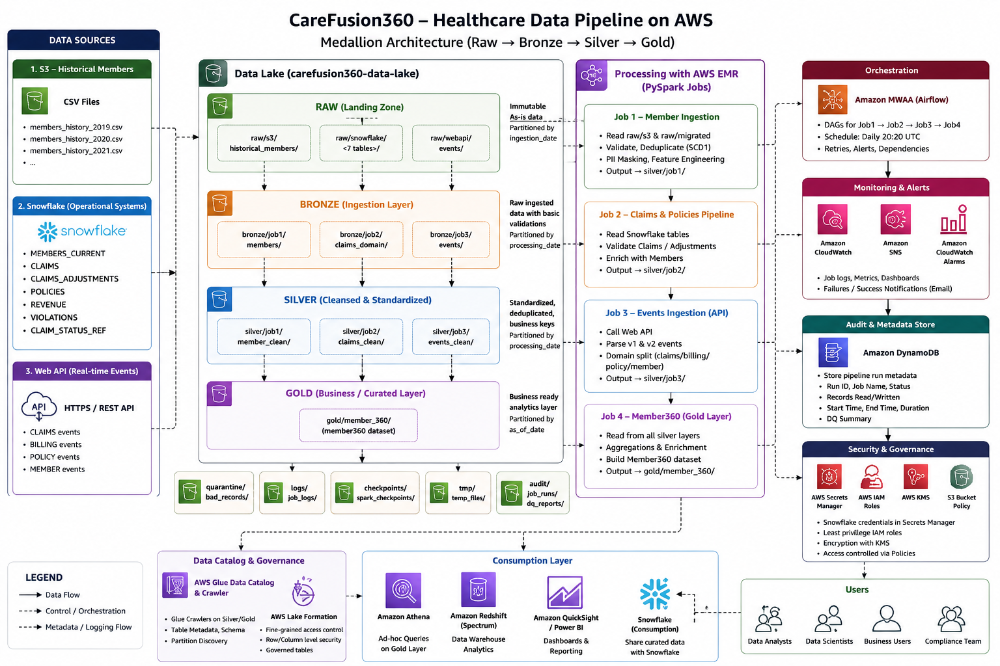

# CareFusion360 — Healthcare Data Engineering Pipeline

[](https://www.python.org/)
[](https://spark.apache.org/docs/latest/api/python/)
[](https://aws.amazon.com/)
[](https://www.snowflake.com/)

CareFusion360 is an end-to-end healthcare data engineering project that demonstrates how fragmented member, claims, policy, billing, revenue, and event data can be consolidated into a curated **Member 360** dataset for analytics and reporting.

> **Portfolio note:** This public repository contains portfolio-safe code and architecture. It does not contain real patient/member records, credentials, tokens, or production secrets.

## Business Problem

Healthcare data is often distributed across multiple systems. CareFusion360 demonstrates a pipeline that brings data from three source systems into a consistent processing workflow, applies data-quality and enrichment logic, and produces a unified Member 360 view.

## Architecture

The solution follows a layered data-lake approach with AWS-based processing and orchestration.



### Data sources

| Source | Data | Processing job |
|---|---|---|
| Amazon S3 | Historical and migrated member data | Job 1 |
| Snowflake | Claims, claim adjustments, revenue, violations, member reference data | Job 2 |
| REST Web API | Near-real-time claims, billing, policy, and member events | Job 3 |

### Processing flow

```text
                         ┌── Job 1: Member Ingestion ──────┐
                         │                                  │
MWAA / Airflow → EMR ────┼── Job 2: Claims & Policies ──────┼──→ Job 4: Member360
                         │                                  │
                         └── Job 3: Web API Events ────────┘
```

The three source jobs are independent. The Member360 master job consumes their outputs after all three source pipelines complete.

## Four PySpark Jobs

### Job 1 — Member Ingestion

Reads historical and migrated member files from S3 and performs:

- duplicate removal
- business-rule validation
- invalid-record quarantine
- SCD-style latest-record selection using Spark Window functions
- member enrichment and age bands
- SSN hashing / PII masking
- deterministic member-key generation
- audit and data-quality fields
- partitioned Parquet output

### Job 2 — Claims & Policies Domain

Reads healthcare domain tables from Snowflake and performs:

- claim deduplication and validation
- member existence validation using a broadcast join
- claim-adjustment reconciliation
- claim fact creation
- revenue validation
- violation deduplication
- invalid-record quarantine
- partitioned Parquet output

### Job 3 — Web API Events

Ingests JSON event data from a REST API and performs:

- retry handling for API calls
- event-level validation and deduplication
- support for schema versions v1 and v2
- nested JSON extraction
- domain separation for claims, billing, policy, and member events
- validation and quarantine of invalid records
- partitioned Parquet output

### Job 4 — Member360 / Gold

Consumes outputs from Jobs 1–3 and creates the curated Member 360 dataset by applying:

- member-level claims aggregation
- revenue aggregation
- violation counts
- streaming event activity metrics
- multi-source joins
- tenure calculation
- lifetime value calculation
- engagement score
- risk tier derivation
- churn-risk flag

Final data is written to both Amazon S3 and Snowflake.

## Data Quality & Governance

The pipeline demonstrates practical healthcare-data engineering patterns including validation, deduplication, quarantine paths, audit fields, reconciliation logic, and PII masking.

Examples include:

- required-field checks
- range validation
- referential validation
- adjustment reconciliation
- duplicate removal
- invalid-record quarantine
- SSN SHA-256 masking
- processing timestamps and data-quality flags

## AWS & Platform Components

The project uses or models the following platform components:

- Amazon S3 — data lake and runtime storage
- Amazon EMR — Spark execution
- Amazon MWAA (Airflow) — orchestration
- AWS Secrets Manager — Snowflake credentials
- IAM / KMS / S3 policies — security controls
- Snowflake — operational and curated warehouse data
- REST API — near-real-time event source

The architecture diagram also shows downstream catalog, governance, monitoring, and analytics components. The public repository focuses on the executable four-job data pipeline and Airflow/EMR orchestration rather than claiming that every surrounding platform component is independently implemented in code.

## Repository Structure

```text
carefusion360/
├── architecture/
│   └── carefusion360-architecture.png
├── airflow/
│   └── dags/
│       └── carefusion360_pipeline.py
├── jobs/
│   ├── job1_member_ingestion.py
│   ├── job2_claims_policies.py
│   ├── job3_api_events.py
│   └── job4_member360.py
├── scripts/
│   ├── submit_job1.sh
│   ├── submit_job2.sh
│   ├── submit_job3.sh
│   ├── submit_job4.sh
│   └── upload_to_s3.sh
├── configs/
├── utils/
├── tests/
├── docs/
├── sample_data/
├── dependencies/
├── requirements.txt
├── requirements-airflow.txt
├── .gitignore
└── LICENSE
```

## Configuration

Sensitive values are intentionally externalized. The Spark jobs use AWS Secrets Manager for Snowflake credentials where required. Public source code should never contain passwords, access keys, tokens, or real healthcare data.

For the Airflow DAG, environment-specific EMR values should be supplied through Airflow Variables and AWS connections rather than committed as secrets.

## Local validation

The repository can be syntax-checked without connecting to AWS:

```bash
python -m pytest -q
```

Local validation uses Python syntax compilation to catch accidental syntax errors before committing changes.

## Cloud deployment concept

1. MWAA starts the scheduled DAG.
2. Airflow creates an EMR cluster.
3. Jobs 1–3 run as independent EMR Spark steps.
4. Job 4 runs after the three source jobs complete.
5. Curated Member360 data is written to S3 and Snowflake.
6. Airflow terminates the temporary EMR cluster.

The DAG is configured for a daily **20:20 UTC** example schedule; deployment environments can change the schedule as needed.

## Technologies

**Languages:** Python, SQL

**Big Data:** Apache Spark, PySpark, Parquet

**AWS:** S3, EMR, MWAA / Airflow, Secrets Manager, IAM, KMS

**Data Platform:** Snowflake

**API:** REST / JSON

**Engineering Patterns:** Medallion-style layers, data-quality validation, quarantine, deduplication, window functions, broadcast joins, partitioning, secure credential retrieval, orchestration

## License

This repository is licensed under the MIT License. See [LICENSE](LICENSE).
